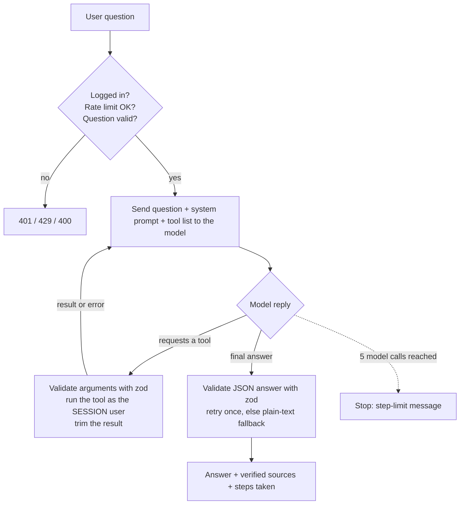

# NexusAI — News Backend

Express + MongoDB + Anthropic AI backend for the NexusAI Regional Current Affairs platform.

---

## Quick Setup

### 1. Drop this folder into your project
```
E-commerce website/
└── server/
    ├── routes/
    │   ├── news.js
    │   ├── ai.js
    │   └── auth.js
    ├── controllers/
    ├── services/
    ├── models/
    ├── middleware/
    ├── server.js
    └── package.json
```

### 2. Install dependencies
```bash
cd server
npm install
```

### 3. Create your .env (copy from .env.example)
```bash
cp .env.example .env
```
Fill in:
- `ANTHROPIC_API_KEY` → from console.anthropic.com
- `NEWS_API_KEY`      → from newsapi.org (free: 100 req/day)
- `JWT_SECRET`        → any long random string

Your MongoDB URI is already pre-filled from your Atlas setup.

### 4. Start the server
```bash
npm run dev       # development with nodemon
npm start         # production
```

Server runs on: http://localhost:5000

---

## API Reference

### News

| Method | Endpoint | Description |
|--------|----------|-------------|
| GET | `/api/news?region=mumbai` | Get articles (cached 30 min) |
| GET | `/api/news?region=mumbai&category=Sports` | Filter by category |
| GET | `/api/news?region=mumbai&limit=20` | Custom limit |
| POST | `/api/news/refresh` | Force fresh fetch from NewsAPI |
| GET | `/api/news/:id` | Single article by ID |
| GET | `/api/health` | Health check |

**Region options:** `mumbai` · `delhi` · `bangalore` · `london` · `newyork` · `singapore`

**Category options:** `Politics` · `Business` · `Technology` · `Sports` · `Weather` · `Health` · `General`

---

### AI

| Method | Endpoint | Body | Description |
|--------|----------|------|-------------|
| POST | `/api/ai/ask` | `{ question, region }` | Chat about today's news |
| POST | `/api/ai/quiz` | `{ region, count }` | Generate MCQ quiz |
| POST | `/api/ai/summarize` | `{ text }` | Summarize any article text |

---

### Agent

| Method | Route | Description |
|---|---|---|
| POST | `/api/agent/ask` | Ask NexusAI a question `{ question, history? }` → `{ runId, answer, sources, followUps, steps, quiz, pendingActions, meta }` |
| POST | `/api/agent/ask/stream` | Same body; **Server-Sent Events**: live `model_start` / `tool_start` / `tool_done` / `model_done` events, then one `result` (or `error`) event |
| PATCH | `/api/agent/runs/:id/feedback` | 👍/👎 on your own answer `{ rating: "up" \| "down" \| "none" }` |
| POST | `/api/agent/actions/bookmark` | The **Confirm** button behind the agent's save proposal `{ articleId }` |
| GET | `/api/agent/stats` | Your own agent analytics (incl. thumbs-up rate) |
| GET | `/api/agent/stats/all` | All users' analytics (admin only) |

### Auth

| Method | Endpoint | Body | Description |
|--------|----------|------|-------------|
| POST | `/api/auth/signup` | `{ name, email, password }` | Register |
| POST | `/api/auth/login` | `{ email, password }` | Login → returns JWT |
| GET | `/api/auth/me` | — (Bearer token) | Get current user |
| PATCH | `/api/auth/preferences` | `{ preferredRegions }` | Update region prefs |

---

## Example Requests

```js
// Fetch Mumbai news (React frontend)
const res = await axios.get('http://localhost:5000/api/news?region=mumbai');
console.log(res.data.articles);

// Ask AI a question
const res = await axios.post('http://localhost:5000/api/ai/ask', {
  question: 'What happened in Mumbai today?',
  region: 'mumbai'
});
console.log(res.data.answer);

// Get a quiz
const res = await axios.post('http://localhost:5000/api/ai/quiz', {
  region: 'mumbai',
  count: 5
});
console.log(res.data.questions);
```

---

## How Caching Works

1. Frontend calls `GET /api/news?region=mumbai`
2. Backend checks MongoDB for articles fetched in the last **30 minutes**
3. If found → returns from DB (fast, no API cost)
4. If not → fetches from NewsAPI → enriches with AI → saves to MongoDB → returns
5. Use `POST /api/news/refresh` to force a fresh fetch anytime

---

## Ask NexusAI — tool-calling AI agent

`POST /api/agent/ask` lets a user ask a news question in plain English. The AI
decides **for itself** which of the app's functions to call, in what order,
until it has enough to answer. That decision loop is what makes it an agent
rather than a single prompt/response.

<!-- Add a demo GIF here once recorded:   -->



### Tools the agent can use

| Tool | What it wraps | Notes |
|---|---|---|
| `search_news` | Full-text search over cached articles; falls back to the existing NewsAPI/RSS pipeline for a region with nothing cached | max 8 results, summaries clipped |
| `get_article` | One article's stored description, AI summary, bias level and fact-check note | the app stores description/summary, not full page text |
| `get_quiz_history` | The **logged-in user's** quiz attempts → overall score, weak topics, recent attempts | takes no arguments |
| `generate_quiz` | Existing Groq quiz generator, plus a difficulty setting | 1–5 questions; returned to the UI as a playable quiz card (the AI never sees the answer key) |
| `compare_regions` | Top recent articles for **two** regions side by side (both fetched in parallel) | optional topic keyword |
| `daily_briefing` | Latest stories from the regions the **logged-in user** follows | takes no arguments |
| `bookmark_article` | **Proposes** saving an article | changes nothing: see "Human-in-the-loop" below |

### Design decisions

- **Identity comes from the session, never from the AI or the request.** `createTools({ userId: req.user.id })` captures the id in a closure. No tool has a user parameter, and zod strips unknown keys, so neither a hostile request body nor a prompt-injected article can make the agent read another user's data.
- **All AI input is untrusted.** Tool arguments are parsed as JSON and validated with zod before any tool runs; bad input becomes an error *result* sent back to the model so it can recover, never a crash. Unknown tool names are handled the same way.
- **Hard limits:** at most 5 model calls per question (tools are switched off on the last one so the model must answer), at most 3 tool calls per step, a 55 s wall-clock budget, and tool results are truncated before re-entering the context.
- **Validated output + verified citations.** The final reply must match a zod schema (`answer` + `sources`). If it doesn't, one retry, then a plain-text fallback. Cited URLs the model was never shown by a tool are dropped, and non-`http(s)` URLs are rejected.
- **Rate limited per user** (8 questions / 10 min) because one question can trigger several model calls.
- **Testable without the real AI:** the model sits behind `services/agentLlm.js`; tests inject a scripted fake model (`tests/helpers/agentFakes.js`).

### More features

- **Live progress (streaming).** `POST /api/agent/ask/stream` sends Server-Sent Events while the agent works, so the UI shows "Searching the news… Writing a quiz…" in real time. It uses `fetch` + a stream reader (not `EventSource`, which can't POST or send the login token), a heartbeat to keep proxies from closing an idle stream, `Cache-Control: no-transform` so compression can't buffer it, and it stops spending AI tokens if the browser disconnects.
- **Conversation memory.** The browser sends the last few turns as `history` (max 6 messages, 1,500 chars each, roles limited to `user`/`assistant` by zod, so nobody can smuggle in a `system` message). Follow-ups like "and what about Delhi?" work.
- **Follow-up suggestions.** The model proposes 2–3 next questions inside its validated JSON; junk entries are dropped without invalidating the answer.
- **Human-in-the-loop for actions.** `bookmark_article` never writes anything: it returns a *proposal*, the loop surfaces it as a pending action taken from the tool's own result (not from the AI's text), and only the user pressing **Confirm** calls `POST /api/agent/actions/bookmark`, which uses the session user's id and is idempotent (`$addToSet`). The AI has no path to change data.
- **Playable quizzes.** `generate_quiz` results reach the UI as a quiz card; finishing it records a normal quiz attempt, so it counts toward streaks and weak-topic analysis.
- **Feedback analytics.** 👍/👎 is stored on the run (a user can only rate their own runs); the stats panel shows the share of rated answers that were helpful.
- **Trace view.** Each answer includes per-model-call timing, tokens and the model used, rendered as a timeline.
- **Model fallback.** `services/agentLlm.js` tries a backup model (`AGENT_FALLBACK_MODEL`, default `llama-3.3-70b-versatile`) when the main model is rate-limited (429), erroring (5xx) or timing out. Each Groq model has its own limits; a model that said "retry in N s" is skipped until then. If every model is limited, the loop waits for short `retry-after` times before giving up with a friendly message.

### Evaluation

`npm run eval` grades the real agent on 20 fixed questions (`evaluation/cases.js`) and writes `evaluation/results.md`:

| Metric | Meaning |
|---|---|
| Right tool(s) chosen | every expected tool was called, none forbidden (small talk must use none) |
| Finished with an answer | no timeout / step limit |
| Cited sources | answer has a source link, counted only when a search actually found articles |
| Avg / median time, tool calls, tokens | cost and speed per question |
| Made-up links removed | citations the model invented, caught by the URL check |

It runs one question at a time with a pause (`--delay=20000`) to respect free-tier limits, uses the first user in the database (`--user=<email>`), and `--limit=5` runs a quick subset. The grading logic is unit-tested without calling the AI.

> Paste your own numbers here after running it, for example: *"Chose the correct tool on 19/20 questions, cited sources on 100% of answerable ones, median response 3.4 s."*

### Analytics

Every question is logged to `AgentRun` (user, question, status, model calls, tool calls, tools used, duration, tokens; auto-deleted after 90 days).
`GET /api/agent/stats` returns the caller's own averages and most-used tools; `GET /api/agent/stats/all` (admin only) aggregates everyone.

### Configuration

`AGENT_MODEL` (optional) overrides the Groq model; it must support tool use. Defaults to `openai/gpt-oss-20b`.
`AGENT_FALLBACK_MODEL` (optional) is the backup tried when the main model is rate-limited or down. Defaults to `llama-3.3-70b-versatile`; write `none` to switch it off.

## Next Steps (Phase 2)

- [ ] Socket.IO for breaking news alerts
- [ ] Daily newsletter cron job (node-cron)
- [ ] PDF current affairs export
- [ ] Google OAuth (passport.js)
- [ ] Bookmark articles (PATCH /api/auth/bookmarks)
